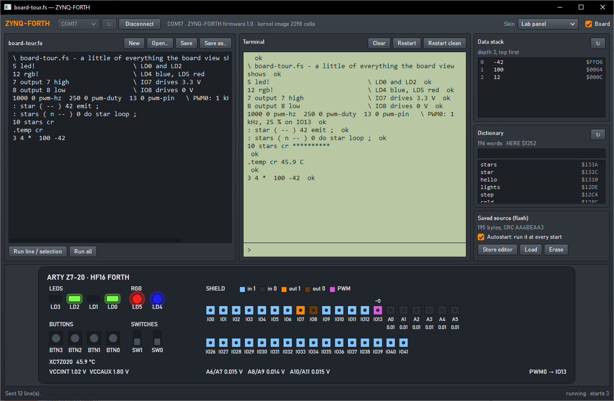
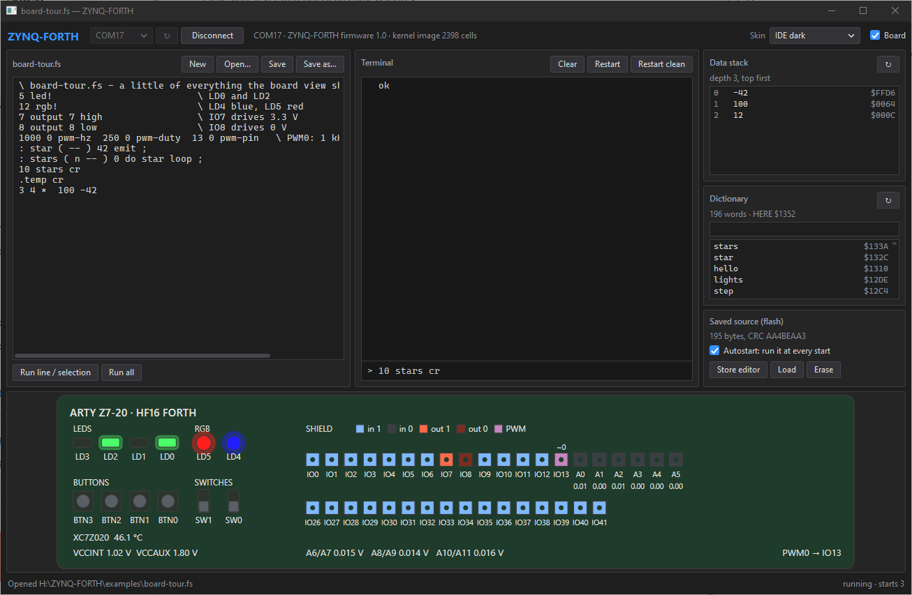
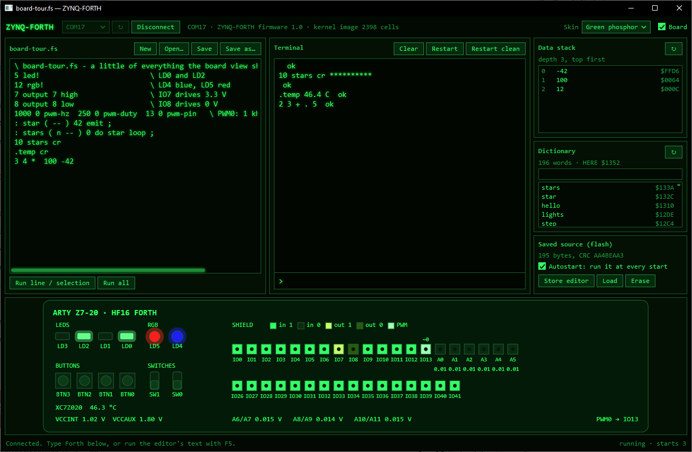
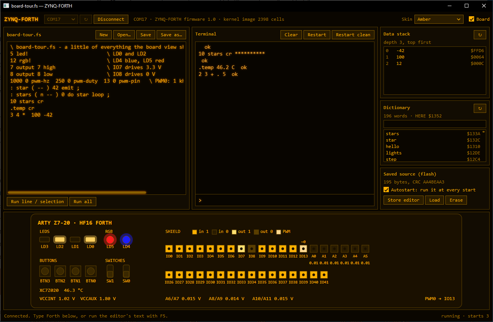
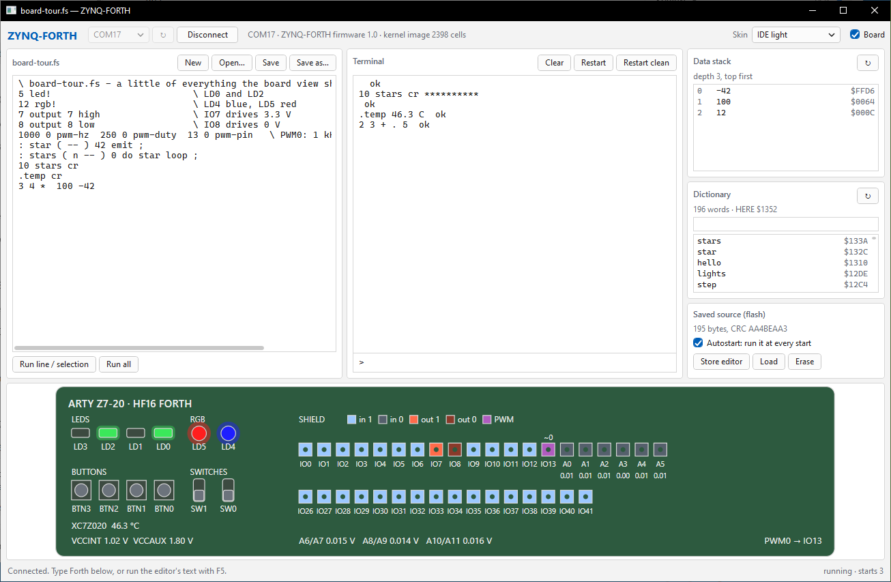

# ZYNQ-FORTH

An interactive Forth on its own CPU, in the FPGA of a Digilent **Arty Z7-20**, with a
Windows app to program it.



- **HF16**, a 16-bit dual-stack CPU in the Zynq's programmable logic whose instructions are
  Forth primitives: one instruction per clock at 50 MHz.
- A **Forth kernel** of 191 words, written in Forth and cross-compiled on the PC: the
  interpreter and compiler, the board's LEDs, RGB LEDs, buttons and switches, 36 shield
  pins, 4 PWM channels and 9 analog inputs through the XADC.
- The **ARM core** loads the kernel and carries Forth's terminal over the USB serial port.
  Any terminal program (PuTTY, Tera Term) talks to Forth directly; the app adds service
  requests on the same line ([docs/Protocol.md](docs/Protocol.md)).
- One Forth source can be **saved in flash** and runs at every start (hold BTN3 to skip it).
- The **app**: editor, terminal, data stack, dictionary, saved source, a live view of the
  board, and five skins: IDE dark, IDE light, Green phosphor, Amber and Lab panel.

| IDE dark | Green phosphor |
|---|---|
|  |  |
| **Amber** | **IDE light** |
|  |  |

## Documentation

- [docs/Manual.md](docs/Manual.md) — the user manual: getting started, the app, the
  interpreter, every word, examples, troubleshooting.
- [docs/Protocol.md](docs/Protocol.md) — the serial protocol, for your own programs.
- [docs/design.md](docs/design.md) — the HF16 instruction set, memory and register maps.

## Try it

```forth
2 3 + .                     \ 5
: sq dup * ;   12 sq .      \ 144
5 led!                      \ LD0 and LD2 on
: blink 10 0 do i led! 200 ms loop 0 led! ;   blink
13 output 13 high           \ shield IO13 to 3.3 V
0 mv@ .                     \ voltage on A0 in mV
1000 0 pwm-hz  250 0 pwm-duty  13 0 pwm-pin   \ 1 kHz, 25 % on IO13
.temp                       \ chip temperature
words
```

More in [examples/](examples).

## Repository

| Path | Content |
|---|---|
| `rtl/` | the HF16 CPU and the Forth system (Verilog): RAM, FIFOs, I/O, shield pins, PWM, XADC scanner, AXI-Lite slave |
| `constr/pins.xdc` | the Arty Z7-20 pins |
| `hw/build_hw.tcl` | Vivado build: Zynq block design, bitstream, `.xsa` |
| `forth/kernel.fs` | the Forth kernel |
| `tools/hf16.py` | cross-compiler and instruction-set simulator |
| `sw/` | the ARM program (bare metal), build, JTAG run, boot image and flash scripts |
| `sim/` | RTL testbench and test inputs |
| `app/` | the Windows app (C#, WPF, .NET 10) with its tests |
| `tools/zforth.py` | a command-line client (pyserial) |
| `examples/` | Forth sources |

## Building

Needs AMD/Xilinx **Vivado and Vitis 2023.2** (the Arty Z7-20 board files are included in
that version), **Python 3** and the **.NET 10 SDK**. The Xilinx launchers are not on PATH;
call them by their full path (here `I:\Xilinx\…`). From the repository root:

```powershell
# bitstream and hardware description: build\hw\forth.bit, forth.xsa (~5 minutes)
I:\Xilinx\Vivado\2023.2\bin\vivado.bat -mode batch -nojournal -nolog -source hw/build_hw.tcl

# kernel image and ARM program: build\sw\forth_app\Debug\forth_app.elf
I:\Xilinx\Vitis\2023.2\bin\xsct.bat sw/build_sw.tcl

# boot image: build\boot\BOOT.bin
.\sw\build_boot.ps1

# the app and its tests
dotnet build app\ZynqForth.slnx
dotnet test app\ZynqForth.slnx
```

To put it on the board:

- **Flash** (permanent): JP4 to JTAG, power on, `.\sw\program_flash.ps1`, then JP4 to QSPI
  and power-cycle.
- **JTAG** (until power-off, for development): JP4 to JTAG, power on,
  `I:\Xilinx\Vitis\2023.2\bin\xsct.bat sw/run.tcl`.

A kernel change (`forth/kernel.fs`) needs only `sw/build_sw.tcl` and a new boot image, no new
bitstream. Test it first in the simulator: `python tools/hf16.py run forth/kernel.fs -f sim/smoke.txt`.

The app runs from `app\src\ZynqForth\bin\Debug\net10.0-windows\ZynqForth.exe`. Its skins are
generated from one colour table: edit `app/tools/make_skins.py` and run it.

## License

MIT, see [LICENSE](LICENSE).
